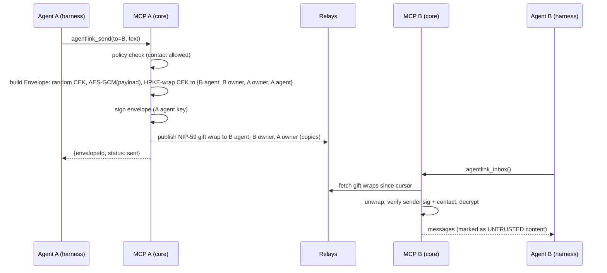
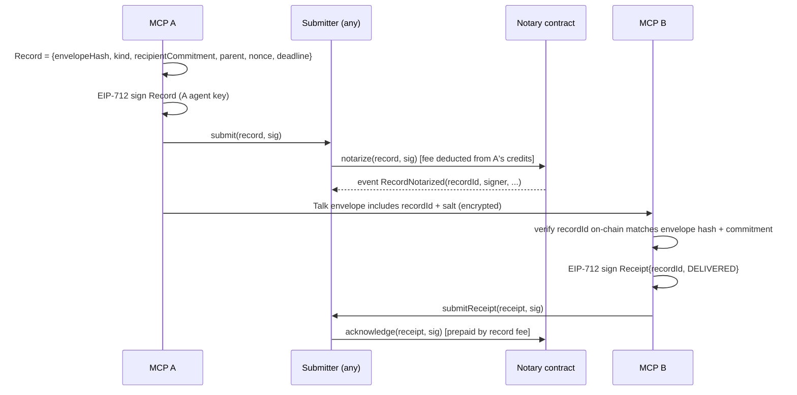

# 03 — Architecture

## 1. Overview

AgentLink is **client software plus a protocol**. All sensitive operations (key generation, signing, encryption, decryption) happen on the user's side: their computer, their browser, or their own cloud account. 4thTech operates only optional, zero-knowledge conveniences (a relay, a transaction submitter, an encrypted file drop that holds only ciphertext, static web pages).

```mermaid
flowchart LR
  subgraph UserSide["User side (keys live here)"]
    H[Harness<br/>Claude / Codex / Gemini / Antigravity]
    MCP[AgentLink MCP server<br/>local stdio or self-hosted HTTP]
    CORE[@agentlink/core<br/>crypto · envelopes · policies · store]
    KC[(Keychain / Worker secrets)]
    LS[(Local store<br/>SQLite / Durable Object)]
    UI[Local approval UI / Desktop app / Owner console PWA]
    H -- MCP tools --> MCP --> CORE
    CORE --- KC
    CORE --- LS
    UI --- CORE
  end

  subgraph Open["Open infrastructure (untrusted)"]
    R[(Nostr relays<br/>public · optional 4thTech · self-hosted)]
    S[(User's own storage, optional<br/>S3-compatible / Drive · Dropbox · OneDrive / IPFS)]
    C[(EVM chains<br/>OCC v2 contracts)]
  end

  subgraph FourthTech["4thTech conveniences (zero-knowledge, optional)"]
    SUB[Submitter / relayer<br/>pays gas, sees only signed hashes]
    DROP[(Encrypted drop<br/>Worker + R2, ciphertext only, 7-day expiry)]
    WEB[Static sites<br/>console · verify · invite]
  end

  CORE -- gift-wrapped envelopes --> R
  CORE -- ciphertext blobs (default) --> DROP
  CORE -- ciphertext blobs (if configured) --> S
  CORE -- signed records --> SUB --> C
  CORE -- direct tx (optional) --> C
  UI -. served by .- WEB
```

**Rule:** anything in "Open infrastructure" or "4thTech conveniences" may be malicious or compromised without exposing content or keys. It can at most withhold or delay service (for a storage backend, including deleting the ciphertext it holds).

---

## 2. Components

| Component | Package / repo | Runs where | Responsibility |
|---|---|---|---|
| **Core** | `@agentlink/core` | Node, browser, Workers | Identity, key management interfaces, envelope build/open, policies, local store interface, orchestration |
| **Crypto** | `@agentlink/crypto` | All | HPKE wrapping, AES-GCM, hashing, EIP-712 signing helpers, key derivation. Pure, audited libraries only |
| **Transport (Nostr)** | `@agentlink/transport-nostr` | All | Publish/subscribe NIP-59 gift-wrapped events; relay pool; dedup; inbox sync |
| **Storage** | `@agentlink/storage` | All | `put/get/delete` of ciphertext blobs; inline adapter; **drop** adapter (default, D-48); S3 adapter (presigned URLs); Google Drive, Dropbox and OneDrive connectors (M2, D-49); IPFS adapter later; storage selection (07 §5.6) |
| **Chain** | `@agentlink/chain` | All | viem clients per chain; OCC v2 contract bindings; fee quotes; credits; submitter client; proof verification |
| **MCP server** | `@4thtech/agentlink` (bin) | Local (stdio) or Worker (HTTP) | Tool definitions, schemas, approval flow, inbound-content sanitization |
| **CLI** | same package, `agentlink` bin | Local | init, pair, policies, optional own-storage setup, backup/restore, verify |
| **Local approval UI** | same package | `127.0.0.1` | Approvals, settings, optional own-storage setup, top-up link |
| **Desktop app** (M2) | `apps/desktop` | User's computer (macOS, Windows, Linux) | Tray app hosting the local MCP server; full local dashboard (shared `packages/ui`); native approval window; OS-biometric owner key; harness auto-setup; signed auto-update (08 §8) |
| **Owner console** | `apps/console` | Browser (PWA) | Passkey owner identity, reading all agent traffic, approvals, policies, proofs, credits |
| **Self-host template** | `apps/cloud-agent` | User's Cloudflare | Always-on agent, inbox Durable Object, remote MCP + OAuth |
| **Verify** | `apps/verify` + CLI | Browser / CLI | Verify proof packs against chain via public RPC |
| **Submitter** | `apps/submitter` | 4thTech Cloudflare Worker | Accepts signed records/receipts/authorizations, simulates, submits; pays gas; rate-limited by on-chain credits |
| **Encrypted drop** | `apps/drop` | 4thTech Cloudflare Worker + R2 | Default store for file ciphertext (D-48): verifies agent-signed uploads, issues short-lived upload targets and signed download URLs, enforces size caps, quotas, rate limits and the hard 7-day expiry; random object keys, no file names, no accounts; holds no user secrets (07 §5.4) |
| **Relay (optional)** | strfry or similar, ops repo | 4thTech or user | Free Nostr relay with longer retention (30 days); stores only gift-wrapped ciphertext |
| **Contracts** | `occ-v2-contracts` (private) | EVM chains | `OCCFeeVault` (credits, fees), `OCCNotary` (records, receipts), `OCCRegistry` (verified agents) |

---

## 3. Packagings (one codebase)

AgentLink goes in **two directions** (D-37):

- **Local:** the `npx` package in M1, then native desktop apps in M2 (D-36). Keys stay on the user's computer.
- **Cloud:** users self-host their always-on agent in their **own** Cloudflare account (template, 08 §3). 4thTech hosts only zero-knowledge parts: console, verify, invite, pay and submitter. A 4thTech-hosted remote MCP stays approval-mode only, P2/M4, after a design review (08 §5).

| Packaging | MCP transport | Keys | Inbox | Notes |
|---|---|---|---|---|
| **Local** (`npx`, M1) | stdio | OS keychain (macOS Keychain, Windows Credential Manager, libsecret); on headless machines without one, an opt-in passphrase-locked file (04 §2.8, D-54) | SQLite in user data dir | Default. Agent active only when harness session runs; inbox syncs from relays on each call |
| **Local, desktop app** (M2) | stdio via the app's bundled CLI shim, relayed to the server hosted by the tray app | OS keychain; owner key gated by OS biometrics in the OS keystore (04 §2.2) | SQLite in user data dir (same schema) | Runs while the user is logged in, so the inbox stays synced between harness sessions; native approval window; full local dashboard (08 §8) |
| **Self-hosted cloud** | Streamable HTTP + OAuth | Worker secrets in **user's** Cloudflare account | Durable Object (SQLite-backed) | Always-on; polls relays with DO alarms; serves remote-only harnesses |
| **Hosted remote (P2, M4)** | Streamable HTTP + OAuth | None server-side; signing via owner's browser passkey | Ciphertext only | Approval mode; every action proposed, owner signs in console |

The MCP **tool surface is identical** across packagings (see 06). Differences live behind the `KeyStore`, `Store` and `ApprovalChannel` interfaces. `Store` and `ApprovalChannel` are in core. The key interfaces are types in `@agentlink/crypto`, so `transport-nostr` and core share them without a dependency cycle (04 §3.1.1, G-2; D-62, accepted by Tali, 2026-10-14, at merge of 4thtech/agentlink#34).

```ts
// @agentlink/crypto (types only). No method returns a private key or a seed (04 §3.1.1).
interface EnvelopeKeys {    // implemented by KeyStore (agent) and OwnerSession (owner)
  signEnvelopeHash(envelopeHash: Uint8Array): Promise<Hex>;  // BIP-340 under "agentlink/envelope/v1"
  signNostr(event): Promise<SignedEvent>;                     // OwnerSession: kinds 13 and 22242 only
  nip44Encrypt(peer: Hex, plaintext: string): Promise<string>;
  nip44Decrypt(peer: Hex, ciphertext: string, o?: { epoch?: number }): Promise<string>;
  unwrapCek(wrapped: WrappedKey, envelopeId: Uint8Array, o?: { epoch?: number }): Promise<Uint8Array>;
}
interface KeyStore extends EnvelopeKeys {
  getPublicBundle(o?: { epoch?: number }): Promise<PublicBundle>;
  sign712(typedData): Promise<Hex>;
}
interface OwnerKeyStore {   // unlocks only with user presence (04 §2.5)
  getPublicKeys(): Promise<OwnerPublicKeys>;
  unlock(presence: OwnerPresence): Promise<OwnerSession>;
  lock(): Promise<void>;
}
interface OwnerSession extends EnvelopeKeys {  // short-lived; never reachable from MCP or agent code
  signOwnerAction(body): Promise<Hex>;
  sign712(typedData): Promise<Hex>;
  close(): Promise<void>;
}
// @agentlink/core
interface Store { /* contacts, threads, envelopes, records, approvals, policies */ }
interface ApprovalChannel { request(a: ApprovalRequest): Promise<ApprovalId>; status(id): Promise<ApprovalStatus>; }
```

---

## 4. Data flows

### 4.1 Send message (Talk, free)



### 4.2 Send file (free, encrypted drop or own storage)

1. Core generates a random file key; encrypts the file with AES-256-GCM in chunks (see 04).
2. Core picks the storage (07 §5.6, policy `files.storage`): own storage if configured, otherwise the **encrypted drop** if the file is within its limits, otherwise `needs_setup`. The adapter uploads the ciphertext and returns a locator plus a download URL valid until expiry: for the drop, a **signed drop URL** obtained with an upload request signed by the agent's drop key (07 §5.4); for S3-compatible storage, a **presigned GET URL**; for a consumer connector (M2), a time-limited **share link**. No backend receives the file name, the file key or the recipient.
3. The envelope payload contains `{fileName, size, mime, sha256(ciphertext), url, fileKey, expiresAt}`; the envelope itself is encrypted as in 4.1.
4. Recipient core downloads, checks SHA-256, decrypts, saves to the allowed folder, and optionally sends a free off-chain ack.
5. On expiry or confirmed receipt (policy), the sender deletes the object; keys are discarded (crypto-shred). The drop follows the same policy (deletion is a DELETE signed with the uploader's drop key) and deletes every object 7 days after upload in any case (D-48).

Files ≤ 12 KB skip storage and travel inline in the envelope.

### 4.3 Notarize with receipts (paid)



Direct mode: any core may call the contract itself (paying gas in the chain's native coin and the fee in an allowlisted stablecoin, D-46). The submitter is a convenience, never a requirement.

`ACCEPTED` and `REJECTED` receipts are commitments: before MB signs one, its core requires an owner approval under policy `commitments.accept` (default `approval`, 06 §3, D-31) and, for records carrying `terms`, checks them (04 §3.4). For terms, the approval that covers MB's `accept` also covers this receipt, once, until its expiry (04 §3.4.2, D-55). The chain is picked automatically (07 §6.3).

### 4.4 Credits top-up

- **Gasless USDC (preferred):** user sends USDC to the agent address → core detects the balance → signs an EIP-3009 `receiveWithAuthorization` authorization with the vault as payee → submitter calls `OCCFeeVault.depositWithAuthorization` → credits appear. (P1, M3; requires native EIP-3009 USDC on that chain.)
- **Testnet faucet (M1):** a 4thTech faucet calls `depositFor` so testers never need gas.
- **Console deposit:** console page lets the owner deposit an allowlisted stablecoin (USDC, USDT where available, xDAI on Gnosis; D-46, 12 §3) for any agent address with any wallet (`depositFor`). Native coins are not fee tokens at launch; they may return later behind a bounded `PRICE_UPDATER` (M4, 12 §3.4). (P1)
- **Direct:** agent with native gas (for the transaction only) calls `deposit` itself with an allowlisted stablecoin. (P0)

### 4.5 Approval

Local: tool returns `pending_approval{id, summary, url}` → local UI at `http://127.0.0.1:<port>/approve/<id>` plus OS notification → owner confirms **with passkey (or owner passphrase)**, producing an owner-signed approval → core verifies the signature and marks it approved → agent retries with `approvalId`. A shell-capable agent cannot approve its own request (04 §2.5).
Desktop app (M2): same flow, but the approval opens in a **native approval window** and the owner confirms with OS biometrics (Touch ID / Windows Hello) instead of a localhost page (04 §2.5).
Console: approval request is sent as an encrypted envelope to the owner key; the console shows it; the owner's signed approval is returned over Talk to the agent.

---

## 5. Trust boundaries

| Party | Can see | Cannot see / do |
|---|---|---|
| **Relays** | Gift-wrap ciphertext, recipient Nostr pubkey (ephemeral sender key per NIP-59), timestamps (randomized), IP of connecting client | Sender identity, content, file keys |
| **4thTech encrypted drop** | Ciphertext blob, size, upload and download times, uploader IP, the uploader's drop key (signed uploads, quotas; unlinkable to the agent's public identity), downloading IP | Content, file name, file key, recipient identity; cannot alter a file undetected (`ciphertextSha256`, `plaintextSha256`); can only deny, delete or delay (I-3). Logs aggregate counters only (04 §4); Cloudflare, as the infrastructure operator, can see request metadata |
| **Own storage provider** (S3-compatible; Drive, Dropbox, OneDrive in M2) | Ciphertext blob, size, uploader and downloader IPs; for consumer connectors also the user's provider account | Content, file name, file key, recipient identity |
| **Chain / public** | Record hash, signer address (pseudonymous agent key), recipient commitment (salted hash), kind, timestamp, receipts, fee payments | Content, recipient identity (without salt) |
| **4thTech submitter** | Signed records and receipts (same as public chain, earlier), submitting IP | Content, keys; cannot forge or alter records (signatures) |
| **4thTech static sites** | Page loads (IP); never the URL fragment | Keys (generated in the browser), content |
| **4thTech relay (optional)** | Same as any relay | Same as any relay |

**Residual risk:** whoever serves the console's JavaScript could serve malicious code. Mitigations: open source, reproducible builds, published build hashes, Subresource Integrity, optional self-hosted console, and the local packaging that avoids the web entirely. See 04.

---

## 6. Technology choices

| Area | Choice | Reason |
|---|---|---|
| Language | TypeScript (strict) everywhere off-chain | One codebase across Node, browser, Workers |
| Monorepo | pnpm + Turborepo, Changesets | Standard, fast |
| EVM client | **viem** (replace ethers) | Typed, tree-shakable, Workers-friendly |
| Crypto | `@noble/curves`, `@noble/hashes`, `@noble/ciphers`, `@hpke/core` (+ WebCrypto AES-GCM) | Audited, pure-JS, runs everywhere |
| Nostr | `nostr-tools` | Reference implementation of NIP-44/59/17 |
| MCP | Official TypeScript MCP SDK; Cloudflare Agents SDK (`McpAgent`) + workers-oauth-provider for Worker | First-party support for stdio and streamable HTTP |
| Local store | SQLite (`better-sqlite3`) | Simple, durable |
| Keychain | `@napi-rs/keyring` (or equivalent) | Cross-platform OS keychain. Headless machines without one: opt-in file KeyStore on `@agentlink/crypto` (04 §2.8, D-54) |
| Contracts | Solidity 0.8.x (exact pin in the contracts repo), **Foundry**, OpenZeppelin v5 | Fast tests, fuzzing, invariants |
| Deterministic deploys | CreateX (CREATE3) | Same addresses on every chain despite per-chain initializer arguments |
| Web apps | Vite + React, static output; shared `packages/ui` built from the Claude Design system | Static hosting, no server state; one component library for local UI and console |
| Desktop app (M2) | `DECISION NEEDED (architecture task, security review)`: e.g. Tauri with a Node sidecar vs Electron | Reuse `@agentlink/core` in Node; OS keystore with biometrics; signed auto-update; shares `packages/ui` with the console (08 §8) |
| Hosting | Cloudflare Workers (static assets, Durable Objects, R2) | One platform for console, submitter, encrypted drop, template |
| Testing | Vitest, Playwright, Foundry fuzz/invariant tests | |

---

## 7. Chains

| Phase | Mainnets | Testnets |
|---|---|---|
| Beta (M1–M3) | Base, Gnosis | Base Sepolia, Gnosis Chiado |
| M4 | + Arbitrum One, Optimism, Polygon PoS | + their testnets |
| Later | Sonic, Avalanche C-Chain, BNB Chain, Celo; Oasis Sapphire for confidential use | |

Each chain has a config entry: chain ID, RPC URLs (several, with fallback), contract addresses (identical via CREATE3 / CreateX within one campaign; the testnet and mainnet sets differ, see 05 §9.1), allowed fee tokens with addresses and decimals, block explorer, confirmations required.
