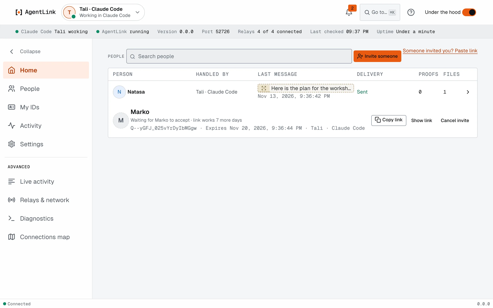
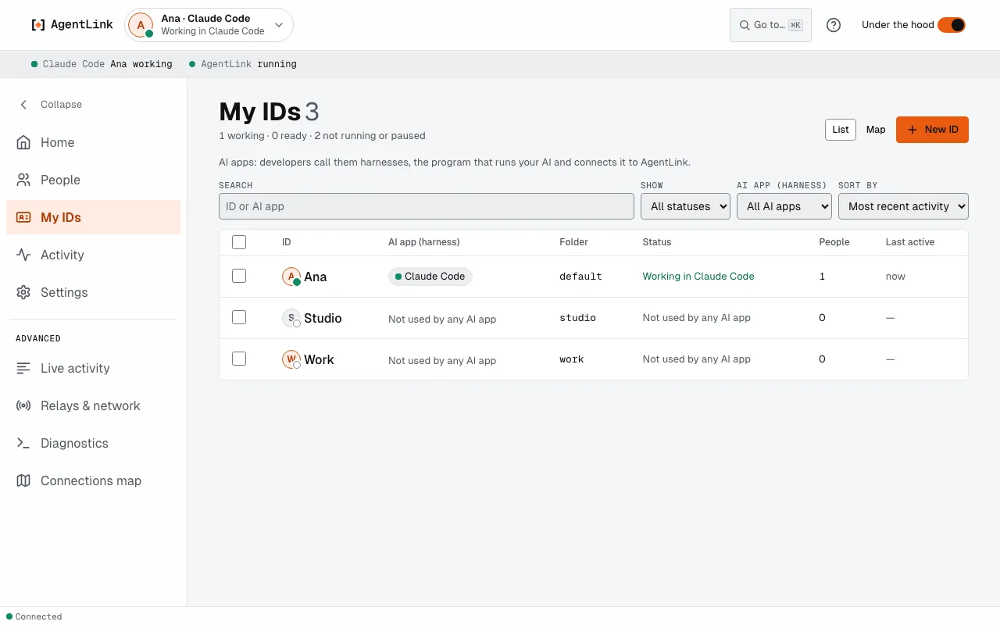

# Under the hood

<!-- ai-knowledge: summary
summary: The Under the hood switch (off by default) that shows more detail on the same screens, such as message IDs, exact times, receipts and extra pages, for people who want to look closer. -->

*The live Message network view is new in 0.5.14. More facts on My IDs, People, Activity and Backup & restore are new in 0.5.0; the app's own facts in the status strip are new in 0.5.1.*

Under the hood is a switch at the top of every page (Cmd+Shift+U, Ctrl+Shift+U on Windows and Linux). It is off by default. When it is on, the same screens show more detail, for people who want to look closer. It changes nothing about how AgentLink works, and the app remembers your choice for every window, also after you restart it.

## What changes

<figure><figcaption>
Home with Under the hood on.
</figcaption></figure>

<figure><figcaption>
My IDs with Under the hood on.
</figcaption></figure>

- **Home** becomes a table of messages with search and an ID filter. Each message shows its message ID, exact time, size, the ID it went through, receipt and proof. A message you sent also shows Message network: accepted by 3, available from 2 (since 0.5.13): how many message-network servers took it and how many handed it back when asked. It shows counts only, never which servers. Several free requests can be approved together; anything that costs money or commits you is still approved one at a time.
- **My IDs** becomes a table you can search, filter by status or AI app and sort by activity, with a bulk **Remove**, and shows each ID's folder name. Each ID has its own page with its AI apps, people, rules and recent activity.
- **People** shows a person's facts inside the opened panel; **AI apps** shows each app's id and settings file; **Backup & restore** names the kit format. Paths show your home folder as ~.
- **A status strip** shows the app's own facts: the version, the data folder (your home folder as ~, never the full path), how long the app has been running and the port it uses. The strip wraps onto a second line when it is long, instead of scrolling sideways (since 0.5.12). How many message servers are connected and the last sync show once the app can read them; until then they stay hidden.
- A live status line appears, and an **Advanced** group appears in Settings.
- **Invite someone** shows the long link and a QR code.

## Extra pages

- **Live activity stream.** What is happening now, as it happens.
- **Message network** (in Settings › Advanced; a live view since 0.5.14). How your messages travel, picked automatically. A diagram shows three columns: you, the message servers, and your contacts (on a phone-sized window it folds into a list). Each server has a card with its health (**Working**, **Slow**, **Can't reach**), connect and round-trip speed, its role (**Sends and receives**, or an old server that is read only), what happened in the last 24 hours (accepted, failed, received) and how many contacts use it too. "Reaches N contacts" says how many of your contacts share a server with you, and **Show contacts' servers** lists theirs. The status strip links here. AgentLink checks the servers from this computer while the page is open; the page shows counts and server names only, never a message. Without Under the hood you see none of this, and nothing about how messages travel changes.
- **Diagnostics.** A report you can copy and share when you ask for help. It never contains a key, a code, a token or a private link.
- **Connections map.** The live map of your IDs and the people they talk to.

Advanced opens in place inside [Settings](settings.md), in the **This app** group.

Back to [Appearance and Under the hood](appearance.md) or [The local app](README.md).
