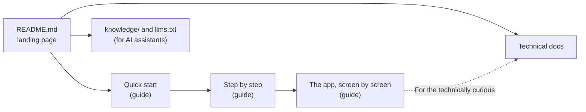

# Docs architecture: what goes where

The map of AgentLink's public documentation: who reads what, which file is the single source of each fact, and how it reaches GitBook. How to write a page is in the [docs model](docs-model.md); upkeep in [`docs-site/MAINTAINING.md`](../../docs-site/MAINTAINING.md). Owner request, 2026-11-12 (docs overhaul): one landing page that leads into self-explanatory docs, with diagrams and screenshots of the real app.

## 1. The reader's path

| Surface | Reader | Job | Single source of |
|---|---|---|---|
| [`README.md`](../../README.md) | Anyone landing on GitHub | What it is in one sentence, a picture, a 3-step start, who it's for, how it connects, then links | Nothing of its own: it summarises and links. Status and Roadmap blocks are generated |
| [`docs-site/guide/`](../../docs-site/guide/README.md) | People who use AgentLink through an AI app | Quick start, step-by-step pages, one page per screen, help | Every user-facing how-to and every UI word (copied from `strings.ts`) |
| [`docs-site/technical/`](../../docs-site/technical/README.md) | Builders, reviewers, verifiers | Concepts, guides, reference | Tool, CLI, format and network reference (specs win) |
| [`docs-site/assets/screens/`](../../docs-site/assets/screens/) | Both of the above, and the README | Screenshots of the real app | Generated only by `pnpm docs:screens` (§3) |
| [`knowledge/`](../../knowledge/agentlink-overview.md) | AI assistants and people asking them | Development overview (shipped, next, being built, later), a compact user guide, desktop app, FAQ, security and privacy and a technical overview (one topic per file, fed whole to Lumina) | Nothing new: condensed from the guide and Status; its status block is generated |
| [`llms.txt`](../../llms.txt) | AI crawlers and assistants | Index of the above | Nothing new |
| [`docs/`](../README.md) | Contributors and agents | Specs, process, runbooks | Specs (`docs/foundation/`) are the source of truth for behaviour |
| GitBook ([wiki.4thtech.io](https://wiki.4thtech.io)) | Public | Published copy of `docs-site/` | Nothing: a copy, never edited there |

**Status and roadmap** have one source, [`docs/status.yaml`](../status.yaml); `node tools/docs-status/index.mjs` writes the blocks in the README, the technical status page and the knowledge overview, and CI fails on drift (`--check`).

## 2. The user guide's shape

1. **What is AgentLink?** and **How AgentLink works, simply** (concepts, diagrams, the three layers).
2. **Quick start**: install → connect your AI app → invite → accept → talk → approve → proof, one screen each.
3. **Step by step**: one page per task (install, connect an AI app, invite, accept, name and check a contact, talk through your AI, approvals, proofs, files, IDs, contacts, recovery kit).
4. **The app, screen by screen** (`local-app/`), **Everyday use** (reference for messages, files, terms, credits), **Coming later**, **Privacy**, **Pricing**, **Help** (troubleshooting, FAQ, glossary).

The three layers of the app are named the same everywhere: **Simple view** (the default), **Get started** (the guided setup) and **Under the hood** (the switch for detail). Words follow 11 §5 and, from D-146, **master code**, **Contact check** and **ID tag** (the last one only under the hood).

## 3. Screenshots

`pnpm docs:screens` builds the app and runs [`e2e/docs-screens/capture.screens.ts`](../../e2e/docs-screens/capture.screens.ts) on the journey harness: two temp homes (never the real HOME), the keychain stand-in file (never the OS keychain), an in-memory relay, a fake drop and Chromium's virtual passkey. The app runs as the owner's own terminal starts it, with no guard switched off. Tali and Natasa set up, invite, accept, name, message; the generator writes `docs-site/assets/screens/<name>.webp` (light theme, 1280 × 800 at scale 2, WebP from Chromium, about 40 to 70 KB each). `DOCS_SCREENS_ONLY=name1,name2` refreshes some. Keys, links and the Contact check digits are new on every run, so a refresh changes bytes even when nothing visible changed: commit screenshots only when a page's words or layout changed.

The older fixture-based capture (`pnpm docs:screenshots`, dark theme, `docs-site/guide/.gitbook/assets/`) is kept for screens the harness cannot reach yet (files, proofs, rules) and for the owner's visual QA set; new pages use `docs-site/assets/screens/`.

## 4. Publishing to GitBook

- GitBook is one space, Git-synced from the private repo `4thtech/wiki.4thtech.io`. Its `scripts/sync-agentlink.mjs` copies `docs-site/guide` → `agentlink/` and `docs-site/technical` → `agentlink/technical/` from a **release tag** (never `main`), rewrites links and records hashes; a PR in the wiki repo publishes on merge.
- From the docs overhaul it also copies `docs-site/assets/` → `agentlink/.gitbook/assets/` (branch `agentlink-assets` in the wiki repo), so the guide's `../assets/screens/…` images resolve there too.
- Never edit pages in GitBook or in the wiki's `agentlink/` folder; change `docs-site/` here.

## 5. Checks

`node tools/check-knowledge-size.mjs`, `node tools/check-knowledge-links.mjs`, `node tools/docs-status/index.mjs --check`, the doc tests in `tools/` (vocabulary, ID vocabulary, retired scope, networks page, skill file, status, knowledge) and `pnpm exec prettier --check .`. They run in CI's `docs-checks` job for documentation-only PRs.
