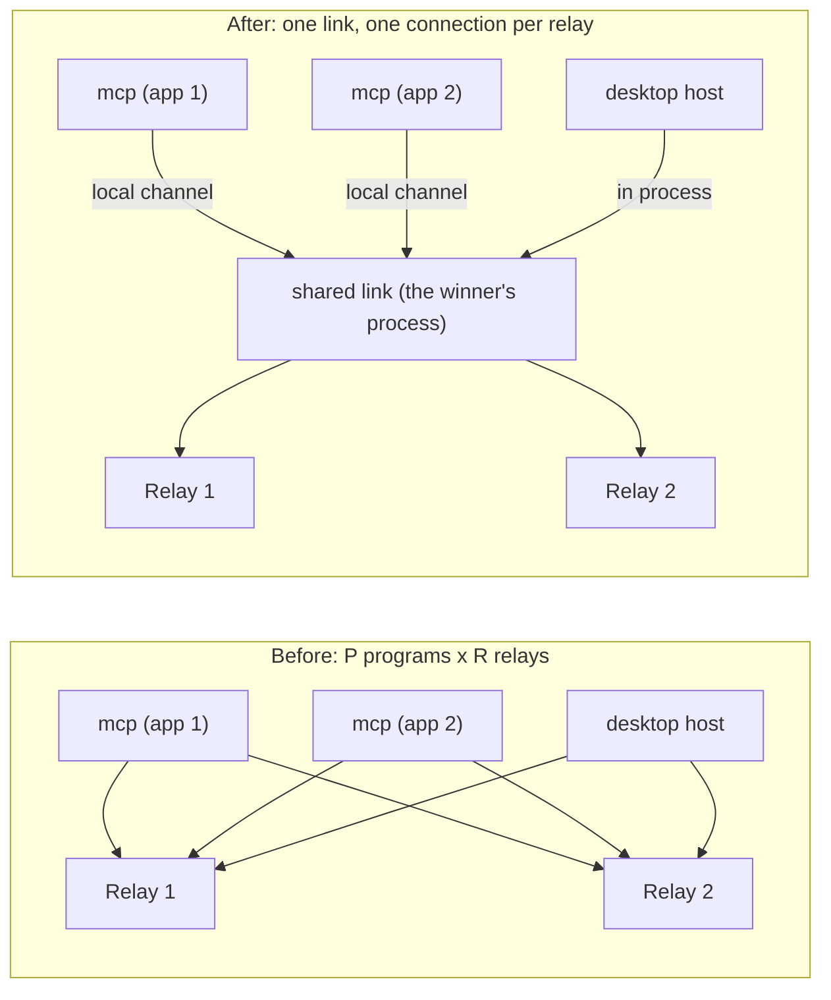

# Shared server connection

<!-- ai-knowledge: summary
summary: How the elected shared relay link works: one connection per relay per computer, election by binding a per-user local endpoint (Unix socket or Windows named pipe), the token file and HMAC proof, the frame protocol, subscription id rewriting, OK routing, authenticated connections per ID, the check lane, caps, hand-over, fallback, logging rules and per-OS details. Shipping in 0.5.18, off by default. -->

> **Status: shipping in 0.5.18, off by default** (`AGENTLINK_SHARED_RELAYS`); planned to be on by default in a later release (D-159). Sources: [D-159](https://github.com/4thtech/agentlink/blob/main/specs/decisions/D-159.md), [07 §4.2 "One relay link per computer"](https://github.com/4thtech/agentlink/blob/main/specs/07-sdk-transport-storage.md), [04 §4 "Local relay link"](https://github.com/4thtech/agentlink/blob/main/specs/04-security-and-crypto.md) and §7. The specs win where this page and a spec differ. A plain-words version is in the [user guide](../../guide/local-app/shared-server-connection.md).

On Node (the MCP process of each AI app, the CLI's long-running commands and the desktop host), the programs of one OS user on one computer share **one connection per relay**. The cloud agent, the owner console and browsers are unchanged. This page uses "relay" for what the app calls a message server.

## Before and after

Without sharing, `P` programs and `R` relays make up to `P × R` connections from one address (more when a program has several IDs), plus a short-lived check connection per relay and program. Some relays accept about 2 connections per address and refuse the rest.

Peak per relay with sharing: 2 connections, the shared one and one for the check lane (below).

## Election

Each long-running program starts one link per process before it opens an ID (`agentlink mcp`, `agentlink ui` since 0.5.19, the desktop host). One-shot commands never join and keep their own connections. A program tries to **bind a per-user local endpoint**; binding is the election, exclusive by nature. The first to bind holds the **shared link** and the relay connections. The others connect to it as clients. The winner is a client of its own link, in process, so it holds no second connection. Its in-process clients are never counted against the cap on channels still in their handshake, so a program that opens many IDs at once shares all of them. A program that was turned away (another protocol version or token) runs the election again about every 30 seconds (bounded), so it joins a compatible link once one holds the endpoint.

- **Unix (macOS, Linux, WSL).** The socket `~/.agentlink/run/relay.sock` in `~/.agentlink/run`, created `0700`. If the address is in use, a probe connect decides: an answer means a live link (be its client); a refusal means a stale socket, removed only after the ownership checks below and then bound. The whole attempt runs under an inter-process lock in the run folder, so two programs never both clear a stale socket and bind. Attempts are bounded (3, with backoff); a failure turns sharing off for a cool-down of 5 seconds, during which a program connects directly instead of spinning.
- **Windows.** The named pipe `\\.\pipe\agentlink-relay-<id>`, where `<id>` is the first 16 hex characters of SHA-256 of the home folder path. Node cannot set an access list on a pipe, and pipe names are shared by all users, so the token proof below is the authentication.
- **Long paths.** When the socket path passes the platform limit (104 bytes with the closing NUL on macOS, 108 on Linux), a short per-user path under the system temporary folder is used (`agentlink-<uid>/r<hash>.sock`, with the same checks). Another user who made that folder first only turns sharing off.
- **Ownership checks.** Before connecting and right after binding, `lstat` (never following a link) checks that the run folder is a real folder of this user with no group or other permission, and that the socket is a socket of this user; right after binding, the socket must also be mode `0600` (a failed permission change is logged with a fixed code and the link is not held). Any other answer refuses the link and the program uses its own pool.

## Token file and proof

The token is 32 random bytes in `~/.agentlink/run/relay-link.json` (`{"v":1,"token":"<64 hex>"}`, mode `0600`; on Windows protected by the user-profile access list). It is created once per user (an exclusive temporary file, then a hard link that fails if another program won, so racing programs agree), reused by every program and every winner, and replaced only when corrupt or a link. It is read without following a link and never logged or sent.

The handshake proves knowledge of it **both ways without sending it**:

1. The program sends `hello` with the protocol version `v: 1`, its CLI version and a random 32-byte nonce.
2. The link answers `challenge` with its own nonce and its proof: HMAC-SHA-256 under the token over a server label and both nonces.
3. The program checks that proof in constant time, and only then sends `prove` with its proof under the client label.
4. The link checks it and sends `accept`.

A wrong proof on either side closes the channel before any relay frame is read. Before the proof, a channel may send at most 4 KiB. Both sides allow 2 seconds for the handshake, well inside the pool's 10-second connect budget, so a stalled link still leaves time to connect directly. **Only the protocol version must match**; the CLI version is kept for counts only, so programs of different releases share. Same-user programs are trusted by design ([04 §2.5](https://github.com/4thtech/agentlink/blob/main/specs/04-security-and-crypto.md)); the proof keeps other OS users out.

## Frames

On the stream, each frame has a 4-byte big-endian length, then a one-line JSON header (at most 1024 bytes) and, for frames that carry relay text, a newline and that text raw (not JSON-escaped, so it cannot grow past the relay frame limit of 131 072 bytes). Parsing is strict: an unknown type, a missing or extra field, a value out of range or an oversized frame is refused with a fixed reason that never repeats content. Frames a program sends: `hello`, `prove`, `open` and `close` of a relay by URL, relay text, and check requests. Frames the link sends: `challenge`, `accept`, relay text, `closed` with a fixed reason code, and check answers.

Two **control frames** are accepted only after the proof: `{"t":"yield"}` (hand-over, below) and `{"t":"status"}`, answered `{"t":"status","programs":<n>}` with a count only (`agentlink doctor` uses it without joining). The count is of client connectors, one per ID.

## What the link does to relay traffic

It only multiplexes, reading just the frame head (type, subscription id, event id), never content.

- **One connection per relay.** It opens a relay only when a client asks, never on its own.
- **Subscription ids are rewritten** to `c<n>:<id>` on `REQ`, `COUNT` and `CLOSE` (`n` numbers the client's virtual connection, so two connections of one client to one relay never collide; an id that would pass 64 characters is refused). `EVENT`, `EOSE`, `CLOSED` and `COUNT` are routed by that id to the one client, with the prefix removed. A client never sees another's frames.
- **`OK` is routed by event id** to the client that sent that event. `NOTICE` goes to every client of that relay.
- **Not an open proxy.** For every request the link re-runs the relay URL rule (only `wss://`) and the connect-time address check (every answer globally routable, connect to the checked address), whatever the client checked. It offers no other kind of connection.
- **Caps.** 32 clients per link, 64 relays per client, 64 shared relay connections in all, 64 event ids in one check read. A request past a cap is refused with a fixed code and the client uses its own connection for that relay. Frames over the size limit are dropped and counted.

## Logins: never shared across IDs

The shared connection to a relay is **never logged in**. The link does not pass its NIP-42 challenge on and drops any `AUTH` sent on it. When a relay answers a client with `auth-required:` and that client may log in there (its own `mayAuthenticate`, sent when it opens the relay), the link moves that client's virtual connection to a **connection of its own**, replays its subscriptions there and passes on that connection's challenge. The client signs its own login with its own key, or none, and the link passes it on unchanged. No other client's events or subscriptions ever go on that connection. Own connections count towards the 64 in all. A client that may not log in stays on the shared connection.

## Check lane

The availability check (a sent message counts as available once a relay serves it back) and the in-app server test run in one machine-wide **check lane** on the link: at most one login-free check connection per relay at a time, never the publishing connection. Waiting checks for a relay are batched into one `{ids, limit}` read **only when they come from the same client**, so event ids of different IDs never share a read. Each answer goes only to the client that asked, and that client verifies it. The check connection closes when its queue is empty. A check the relay refuses or leaves silent stays "Sent, availability unknown", as before. This amends the check of D-156 (7). Without a link, the program does today's fresh, login-free check on a connection of its own, never on a virtual one.

## Hand-over and fallback

- **The winner exits.** Every client sees its virtual connections close and re-races after a random 0 to 500 ms: bind, or connect. Each pool reconnects and syncs from its cursor, and the outbox republishes whatever had no `OK`, so no message is lost.
- **The desktop host** asks a program that holds the link to hand it over when it starts (`yield`, after the proof): that program stops accepting, closes every channel, unbinds and rejoins as a client after about 250 to 500 ms, and the host binds without a delay. The long-running app then usually holds the link.
- **Fallback.** A failed bind and connect, a failed ownership check, a wrong proof, a protocol mismatch, a stall past the handshake time or a cap makes the program use its own pool, which is the behaviour before D-159. Sockets opened after a failure go direct for 30 seconds before the link is tried again. Older AgentLink versions never join and coexist.
- **A hostile link** (another program of the same user) can only drop or delay, like a hostile relay; every client verifies every event (I-5).

## What crosses the channel

Only gift wraps (ciphertext), events already signed by the sending program (envelopes and NIP-42 login events), subscription filters, event ids and relay URLs. Never a key, seed, plaintext, file key, salt, OAuth token, owner secret, storage link or drop URL (I-1, I-2). Each program keeps its own `RelayPool`, `KeyStore`, `mayAuthenticate`, signature checks and size limits; the seam is the `RelayConnector` interface (07 §4.2), and a client's connector returns a virtual socket.

## Logging

Counts and fixed codes only (I-7): clients, relays, dropped frames, refusals by code. Never a frame, subscription id, event id, relay URL, path or the token. No log line identifies a program or an ID.

## Privacy

IDs on one computer now share a connection, so a relay can tell they belong together; they already share an IP address. Content, senders and recipients stay hidden ([04 §7](https://github.com/4thtech/agentlink/blob/main/specs/04-security-and-crypto.md); [threat model](threat-model.md)). `AGENTLINK_SHARED_RELAYS` accepts `1`, `on`, `true` or `yes` for on; anything else, or unset, is off.

## Seeing it

- `agentlink doctor`: "Shared server connection: on, {n} IDs", "on, but this program uses its own connections", or "off". It reads the switch from its own environment and joins nothing.
- Under the hood › Message network: "Shared server connection: on · {n} IDs on this computer" or "off · each program connects on its own". `GET /api/ui/network` and `POST /api/ui/network/test` answer `sharedLink: {on, programs}`, a boolean and a count.

Back to [Transport](transport.md) or [Security model](security-model.md).
