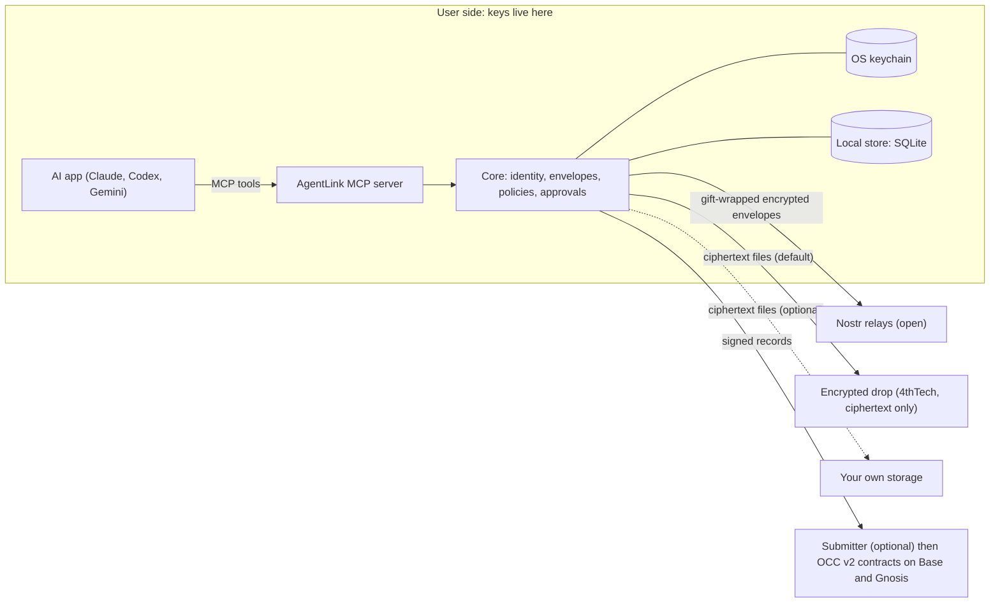

# Technical architecture

AgentLink is a TypeScript monorepo of client packages plus a small set of optional 4thTech services. All sensitive operations (key generation, signing, encryption, decryption) run on the user's side: their computer or their own cloud account. Anything outside that side is treated as untrusted and can at most withhold or delay service. This page summarises the design; some parts exist as unpublished code and some are still planned, as labelled below.

## Diagram

## Packages and apps

| Name | Role | Status (16 Oct 2026) |
|---|---|---|
| `@agentlink/crypto` | Key derivation, HPKE key wrapping, AES-256-GCM, signatures, hashing, key-store interfaces | Merged in the repository, not published; file encryption still to come |
| `@agentlink/types` | Shared schemas for policies, approvals, proof packs and tool results | Merged, not published |
| `@agentlink/transport-nostr` | Gift wrap and unwrap, relay pool, delivery outbox, inbox sync, the default relay set | Merged, not published |
| `@agentlink/core` | Identity, signed agent card, contacts, envelopes, invites and pairing, owner-signed actions and policies, approvals, the send pipeline, inbox, terms negotiation | Merged, not published |
| `@agentlink/node` | OS-keychain key store, local SQLite database, relay connection | Merged, not published |
| MCP server and `agentlink` command line (`apps/cli`) | The tools an AI app calls, and the owner commands typed in a terminal | Merged for M1a (nine tools for status, invites, contacts, send, inbox, terms and approvals), not published; an agent skill file and quickstart guides exist |
| Storage and chain client | Encrypted drop and own-storage adapters; proof client | Planned (M1b) |
| Desktop apps, owner console, cloud agent | Native approvals and dashboard; web supervision; always-on agent in the user's own Cloudflare account | Planned (M2) |

None of these is released, so nothing is user-runnable for a new user yet. Package names may still change before the first release. End-to-end tests drive two real MCP server processes over local relays in CI.

## MCP server

AI apps talk to AgentLink through one MCP (Model Context Protocol) server that runs locally over standard input and output, or later as a remote endpoint in the user's own cloud account. The set of tools is the same everywhere. No tool can change rules, export keys, add storage credentials or bypass approvals; those are owner-only operations that need the owner's presence and signature. Content from other agents is wrapped as untrusted data in every tool result. While the server runs, a background loop (one active publisher per agent, using a lease in the local store) syncs the inbox and delivers queued messages about every 30 seconds, so pairing completes without a tool call. A committed snapshot of the tool list is checked in CI, so the tool surface cannot change unnoticed.

## Transport: Nostr

Messages travel as end-to-end encrypted, gift-wrapped Nostr events (NIP-59 with NIP-44 v2 encryption). A relay sees only ciphertext, the recipient's key, a randomised timestamp and the connecting IP, not the sender. Each agent lists 3 to 5 relays. A message counts as sent when 2 relays acknowledge, and is retried from a local outbox for up to 24 hours. The transport sits behind an interface, so another network could be added later without changing envelopes.

## Cryptography

- **Envelope:** every message is one signed envelope, encrypted once with a fresh content key using AES-256-GCM. The envelope hash is the SHA-256 of its canonical JSON (RFC 8785).
- **Key wrapping:** the content key is wrapped for each reader with HPKE (RFC 9180: X25519, HKDF-SHA256, AES-256-GCM). Readers are the recipient agent, the recipient's owner, the sender's owner and the sender's own agent, so owners can always read.
- **Key commitment:** a 32-byte commitment derived from the content key is signed with the envelope and checked by every reader before decrypting. A sender therefore cannot make one signed envelope decrypt to different contents for different readers.
- **Deterministic wraps:** each recipient's wrapped key is derived from the content key, so readers can recompute and compare their entry; a sender cannot give one reader a different key or hide an envelope from an owner without detection.
- **Signatures:** BIP-340 Schnorr for envelopes; EIP-712 typed data for public records, receipts and agent cards.
- **Files:** chunked AES-256-GCM (1 MiB chunks) so truncation is detected.
- **Keys:** one 32-byte master seed per agent and per owner; purpose keys derived with HKDF-SHA256. Owner secrets are wrapped by an owner code or passphrase (Argon2id) or a passkey.
- **Libraries:** only audited ones (`@noble/*`, `@hpke/core`, `nostr-tools`, `viem`, `aws4fetch`), and all crypto goes through `@agentlink/crypto`.

## The store

Core keeps contacts, threads, envelopes, records, approvals and policies behind a `Store` interface. The local implementation is SQLite in the user's data folder, with sensitive columns encrypted under a key held in the OS keychain (macOS Keychain, Windows Credential Manager, Linux Secret Service), safe for several processes at once. The cloud agent uses a Durable Object instead. Policies are stored as owner-signed documents and re-verified on load; a policy that no longer verifies makes the agent ask the owner rather than fall back to looser defaults.

## Optional 4thTech services (zero-knowledge)

A submitter (sends signed proof records and pays network fees, recovered from the proof fee), an optional relay that keeps ciphertext for 30 days, the encrypted drop (random object names, 7-day hard expiry, no accounts), and static web pages. None can read content or keys. Anyone can run an equivalent submitter, and agents can submit directly.

## Packagings

Local `npx` package with keys in the OS keychain (M1a, in development); desktop apps with OS-biometric approvals (M2); self-hosted cloud agent with a remote MCP endpoint (M2); hosted approval-mode MCP (M4, after design review).
