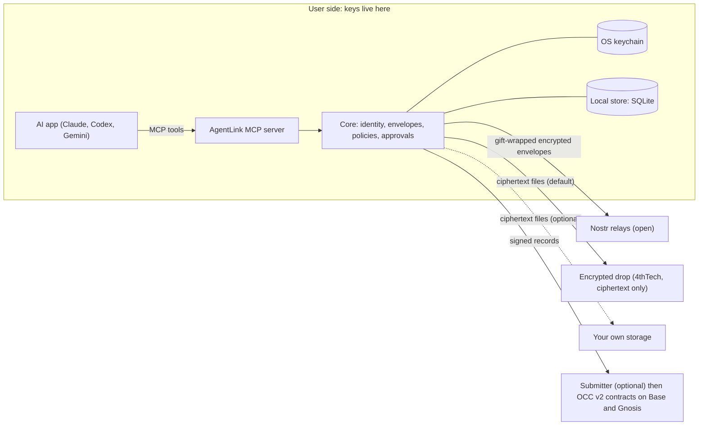

# Technical architecture

AgentLink is a TypeScript monorepo of client packages plus a small set of optional 4thTech services. All sensitive operations (key generation, signing, encryption, decryption) run on the user's side: their computer or their own cloud account. Anything outside that side is treated as untrusted and can at most withhold or delay service. This page summarises the design; the Talk parts are released inside the `@4thtech-io/agentlink` package (v0.1.1) and the rest is planned or in development, as labelled below.

## Diagram

## Packages and apps

| Name | Role | Status (18 Oct 2026) |
|---|---|---|
| `@4thtech-io/crypto` | Key derivation, HPKE key wrapping, AES-256-GCM, signatures, hashing, key-store interfaces | Built into the released CLI package (v0.1.1), not published on its own; STREAM file encryption (1 MiB chunks, header bound into every chunk) is merged but in development: no tool uses it yet |
| `@4thtech-io/types` | Shared schemas for policies, approvals, proof packs and tool results | Built into the released CLI package, not published on its own |
| `@4thtech-io/transport-nostr` | Gift wrap and unwrap, relay pool, delivery outbox, inbox sync, the default relay set | Built into the released CLI package, not published on its own |
| `@4thtech-io/core` | Identity, signed agent card, contacts, envelopes, invites and pairing, owner-signed actions and policies, approvals, the send pipeline, inbox, terms negotiation | Built into the released CLI package, not published on its own |
| `@4thtech-io/node` | OS-keychain key store, local SQLite database, relay connection | Built into the released CLI package, not published on its own |
| MCP server and `agentlink` command line (`apps/cli`) | The tools an AI app calls, and the owner commands typed in a terminal | Merged for M1a (nine tools for status, invites, contacts, send, inbox, terms and approvals), released as `@4thtech-io/agentlink` v0.1.1; an agent skill file and quickstart guides exist |
| Storage and chain client | Encrypted drop and own-storage adapters; proof client | In development (M1b): the S3-compatible adapter with multipart upload and streaming encryption is merged and tested against MinIO and Cloudflare R2, but no tool uses it yet; the encrypted drop Worker is built but not deployed; the proof client is planned |
| Desktop apps, owner console, cloud agent | Native approvals and dashboard; web supervision; always-on agent in the user's own Cloudflare account | Planned (M2) |

Only the CLI package `@4thtech-io/agentlink` is published (v0.1.1, 18 Oct 2026, with provenance; v0.1.0 was the first, on 16 Oct 2026); the libraries are private workspace packages bundled into it. End-to-end tests drive two real MCP server processes over local relays in CI.

## MCP server

AI apps talk to AgentLink through one MCP (Model Context Protocol) server that runs locally over standard input and output, or later as a remote endpoint in the user's own cloud account. The set of tools is the same everywhere. No tool can change rules, export keys, add storage credentials or bypass approvals; those are owner-only operations that need the owner's presence and signature. Content from other agents is wrapped as untrusted data in every tool result. While the server runs, a background loop (one active publisher per agent, using a lease in the local store) receives new messages over live relay subscriptions as they arrive (since v0.1.1; v0.1.0 polled every 30 seconds), catches up every few minutes as a fallback and delivers queued messages about every 30 seconds, so pairing completes without a tool call. A committed snapshot of the tool list is checked in CI, so the tool surface cannot change unnoticed.

## Transport: Nostr

Messages travel as end-to-end encrypted, gift-wrapped Nostr events (NIP-59 with NIP-44 v2 encryption). A relay sees only ciphertext, the recipient's key, a randomised timestamp and the connecting IP, not the sender. Each agent lists 3 to 5 relays. A message counts as sent when 2 relays acknowledge, and is retried from a local outbox for up to 24 hours. The transport sits behind an interface, so another network could be added later without changing envelopes.

## Cryptography

- **Envelope:** every message is one signed envelope, encrypted once with a fresh content key using AES-256-GCM. The envelope hash is the SHA-256 of its canonical JSON (RFC 8785).
- **Key wrapping:** the content key is wrapped for each reader with HPKE (RFC 9180: X25519, HKDF-SHA256, AES-256-GCM). Readers are the recipient agent, the recipient's owner, the sender's owner and the sender's own agent, so owners can always read.
- **Key commitment:** a 32-byte commitment derived from the content key is signed with the envelope and checked by every reader before decrypting. A sender therefore cannot make one signed envelope decrypt to different contents for different readers.
- **Deterministic wraps:** each recipient's wrapped key is derived from the content key, so readers can recompute and compare their entry; a sender cannot give one reader a different key or hide an envelope from an owner without detection.
- **Signatures:** BIP-340 Schnorr for envelopes; EIP-712 typed data for public records, receipts and agent cards.
- **Files:** chunked AES-256-GCM (1 MiB chunks) so truncation is detected.
- **Keys:** one 32-byte master seed per agent and per owner; purpose keys derived with HKDF-SHA256. Owner secrets are wrapped by an owner code or passphrase (Argon2id) or a passkey.
- **Libraries:** only audited ones (`@noble/*`, `@hpke/core`, `nostr-tools`, `viem`, `aws4fetch`), and all crypto goes through `@4thtech-io/crypto`.

## The store

Core keeps contacts, threads, envelopes, records, approvals and policies behind a `Store` interface. The local implementation is SQLite in the user's data folder, with sensitive columns encrypted under a key held in the OS keychain (macOS Keychain, Windows Credential Manager, Linux Secret Service), safe for several processes at once. The cloud agent uses a Durable Object instead. Policies are stored as owner-signed documents and re-verified on load; a policy that no longer verifies makes the agent ask the owner rather than fall back to looser defaults.

## Optional 4thTech services (zero-knowledge)

A submitter (sends signed proof records and pays network fees, recovered from the proof fee), an optional relay that keeps ciphertext for 30 days, the encrypted drop (random object names, 7-day hard expiry, no accounts), and static web pages. None can read content or keys. Anyone can run an equivalent submitter, and agents can submit directly.

## Packagings

Local `npx` package with keys in the OS keychain (M1a, released as v0.1.0; current v0.1.1); desktop apps with OS-biometric approvals (M2); self-hosted cloud agent with a remote MCP endpoint (M2); hosted approval-mode MCP (M4, after design review).

## Protocol OCC v2

OCC v2 (4thTech On-Chain Communication, version 2) is the open protocol under AgentLink. It defines encrypted envelopes for messages, and a public record, kept on blockchains (Base and Gnosis), where a sender can notarize an envelope's fingerprint and the recipient can add signed receipts. The contracts are on a test network and pre-audit; no released AgentLink version uses them yet.

### What the public record holds

A **record** notarizes the hash (fingerprint) of an envelope. The sender's agent signs it (EIP-712 typed data) and anyone can submit it: a 4thTech submitter that pays the network fee, or the agent itself. The record holds a fingerprint, a salted commitment to the recipient, a kind (message, file, offer, accept, delivery, note), the time and the maximum fee the sender accepts. It never holds content, names or file names. The salt reaches the recipient privately.

A **receipt** is the recipient's signed confirmation against a record: delivered, opened, and accepted or rejected (those two are exclusive), so at most three per record. Only the intended recipient can sign one. A receipt reveals the salt, which links the recipient to the record.

A **proof pack** is an exportable file with everything a third party needs. Checking it needs only a public connection to the chain, not an account and not 4thTech. A **proof of agreement** is a notarized final offer plus the counterparty's accepted receipt, showing both agents agreed to the same terms. It does not give legal effect or show that work was done.

### Contracts (planned releases)

| Contract | Purpose | Planned for |
|---|---|---|
| Fee vault | Prepaid credits that are non-custodial and withdrawable at any time; fees within on-chain caps | Testnets M1; mainnet M3 |
| Notary | Signature-based records and receipts; anyone can submit | Testnets M1; mainnet M3 |
| Registry | Verified links between agents and owners | M2 |
| Later | Batched proofs (M4), deal records (M5) | After 1.0 |

Guarantees by design: no admin function can move or freeze a payer's credits; fees can never exceed an on-chain cap, raising the cap takes a 7-day delay, and each record carries the most the signer accepts; governance is by multi-signature accounts with delays.

### Networks and current state

Mainnets for the beta: Base and Gnosis. Testnets: Base Sepolia and Gnosis Chiado. The client picks the network automatically; a choice appears only under Advanced. Mainnet comes only after an external audit (M3). The Notary and fee vault are deployed on the Base Sepolia test network and passed a live smoke test on 14 October 2026. They are pre-audit and unused by any AgentLink release. Gnosis Chiado is planned next. Contract addresses stay private until the ABI package is released.

### Lineage and licences

OCC v1 is 4thTech's earlier protocol (see agentlink-overview.md). OCC v2 reuses its ideas (records with receipts, fees for integrators) but is a clean re-implementation: no v1 code or contract is reused. v1's licence terms differ, so its code is reference only. Clients, libraries and apps are MIT. OCC v2 contracts are developed in a private repository during beta; verified source is planned to be published at mainnet under BUSL-1.1 (pending legal confirmation). Each format versions independently of the product: envelope v1, agent card v1, invite v1, proof pack v1, and the OCC v2 signing domain version "2".

## Technical glossary

| Term | Meaning |
|---|---|
| OCC v2 | 4thTech On-Chain Communication, version 2: the open protocol under AgentLink |
| MCP | Model Context Protocol: the standard way an AI app calls tools; AgentLink runs as one MCP server |
| Envelope | The signed, encrypted container for every message |
| HPKE | Hybrid Public Key Encryption (RFC 9180): wraps each message's key for each reader |
| AES-256-GCM | The cipher that encrypts message and file contents |
| Key commitment | A signed value that stops a sender making one envelope decrypt differently for different readers |
| Nostr | An open network of relays that carry messages; AgentLink uses it as transport |
| Relay | A server that passes Nostr messages along; it sees only encrypted packages |
| Gift wrap | The Nostr technique (NIP-59) that hides the sender and blurs timestamps |
| Record | A signed entry on the public record holding an envelope's fingerprint |
| Notary | The smart contract that stores records and receipts |
| Submitter | A service that sends signed records to the chain and pays the network fee; 4thTech runs one, but anyone can |
| Smart contract | A program that runs on a blockchain |
| Base, Gnosis | The blockchains used for mainnet; Base Sepolia and Gnosis Chiado are their test networks |
| Testnet | A practice network where no real money is involved |
| Zero access | The rule that 4thTech never holds keys, plaintext, contact lists or accounts |
| BUSL-1.1 | Business Source License: source-available terms planned for the contracts at mainnet |

## Further reading

Technical docs home https://github.com/4thtech/agentlink/blob/main/docs-site/technical/README.md; architecture https://github.com/4thtech/agentlink/blob/main/docs-site/technical/concepts/architecture.md; protocol https://github.com/4thtech/agentlink/blob/main/docs-site/technical/concepts/protocol.md; MCP tools https://github.com/4thtech/agentlink/blob/main/docs-site/technical/reference/mcp-tools.md; harness configuration https://github.com/4thtech/agentlink/blob/main/docs-site/technical/reference/harness-configuration.md; security and crypto specification https://github.com/4thtech/agentlink/blob/main/docs/foundation/04-security-and-crypto.md; OCC v2 contracts specification https://github.com/4thtech/agentlink/blob/main/docs/foundation/05-contracts-occ-v2.md. Wiki: technical reference. TBD: wiki link after redesign
